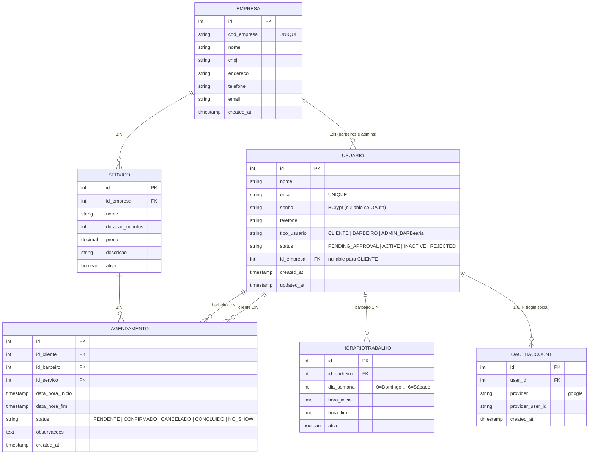

# site-para-barbearias

# 💈 BarberFlow

> Um sistema completo para gerenciamento de barbearias, desenvolvido com arquitetura cliente-servidor e preparado para evoluir para uma solução real de mercado.

## 📖 Sobre o projeto

O **BarberFlow** é uma plataforma para gerenciamento de barbearias que centraliza o processo de agendamento, administração de clientes, funcionários, serviços, pagamentos e relatórios em um único sistema.

O projeto foi concebido seguindo uma arquitetura escalável, permitindo que uma API REST seja compartilhada entre aplicações web e futuras aplicações mobile.

O objetivo é desenvolver um sistema moderno, seguro e organizado que possa servir tanto como projeto de portfólio quanto como base para um produto comercial.

---

# 🏗️ Arquitetura

# 🎯 Objetivos

- Digitalizar o gerenciamento de uma barbearia.
- Facilitar o processo de agendamento online.
- Centralizar informações de clientes e funcionários.
- Disponibilizar uma API reutilizável para aplicações web e mobile.
- Desenvolver um projeto com arquitetura próxima à utilizada no mercado.

---

# 👥 Tipos de usuários

## Cliente

- Cadastro
- Login
- Editar perfil
- Agendar serviços
- Cancelar agendamentos
- Histórico de atendimentos
- Avaliar barbeiros
- Receber notificações
- Visualizar promoções
- Consultar serviços e preços

---

## Funcionário (Barbeiro)

- Login
- Visualizar agenda
- Confirmar atendimentos
- Finalizar atendimentos
- Bloquear horários
- Consultar clientes
- Registrar observações
- Gerenciar portfólio

---

## Administrador

- Gerenciar clientes
- Gerenciar funcionários
- Gerenciar serviços
- Definir preços
- Gerenciar horários
- Gerenciar pagamentos
- Emitir relatórios
- Administração completa do sistema

---

# ✨ Funcionalidades

## 🔐 Autenticação

- Cadastro de usuários
- Login
- Logout
- Recuperação de senha
- Controle de permissões por perfil
- JWT

---

## 📅 Agendamentos

- Escolha do serviço
- Escolha do barbeiro
- Seleção de data
- Seleção de horário
- Verificação automática de disponibilidade
- Cancelamento de reservas
- Confirmação de atendimento

---

## 💇 Serviços

Cadastro de:

- Nome
- Descrição
- Preço
- Duração
- Categoria

Exemplos:

| Serviço | Duração |
|----------|----------|
| Corte | 30 min |
| Barba | 20 min |
| Corte + Barba | 50 min |

---

## 📆 Agenda dos barbeiros

Visualização diária da agenda.

Exemplo:

```
09:00 João - Corte
10:00 Pedro - Barba
11:00 Lucas - Corte + Barba
```

Ações:

- Confirmar atendimento
- Cancelar
- Finalizar

---

## 💳 Pagamentos

Registro de:

- Valor
- Método
- Status
- Data

Métodos suportados:

- Pix
- Dinheiro
- Cartão

---

## ⭐ Avaliações

Clientes podem:

- Dar nota
- Escrever comentários

O sistema calcula:

- Média de avaliações
- Histórico do barbeiro

---

## 📸 Portfólio

Cada barbeiro poderá cadastrar:

- Fotos
- Descrição do corte
- Categoria

---

## 🔔 Notificações

Envio automático de:

- Confirmação de agendamento
- Lembretes
- Cancelamentos
- Promoções

---

## 📊 Relatórios

Administrador poderá visualizar:

- Faturamento
- Serviços mais vendidos
- Clientes atendidos
- Horários de maior movimento
- Desempenho dos barbeiros

---

# 🌐 API REST

## Autenticação

```
POST /auth/login
POST /usuarios
GET  /usuarios/{id}
PUT  /usuarios/{id}
```

---

## Clientes

```
GET /clientes
GET /clientes/{id}
PUT /clientes/{id}
```

---

## Funcionários

```
GET /barbeiros
POST /barbeiros
PUT /barbeiros/{id}
```

---

## Serviços

```
GET /servicos
POST /servicos
DELETE /servicos/{id}
```

---

## Agendamentos

```
GET /agenda
POST /agendamentos
PUT /agendamentos/{id}
DELETE /agendamentos/{id}
```

---

# 🗄️ Modelo de Dados

Principais entidades:

- Usuário
- Cliente
- Funcionário
- Serviço
- Agendamento
- Pagamento
- Avaliação
- Portfólio
- Horário
- Notificação

O banco foi modelado para garantir integridade referencial e permitir futuras expansões, como programas de fidelidade, múltiplas unidades e integração com gateways de pagamento.

---

# 🔒 Requisitos Não Funcionais

## Segurança

- Senhas criptografadas
- JWT
- HTTPS
- Controle de acesso por perfil
- Proteção contra SQL Injection

## Desempenho

- API otimizada
- Banco indexado
- Cache quando necessário

## Disponibilidade

- Backup automático
- Logs
- Recuperação de falhas

## Usabilidade

- Interface responsiva
- Design intuitivo
- Compatível com dispositivos móveis

## Manutenção

- Código limpo
- Arquitetura em camadas
- Documentação da API
- Versionamento com Git

---

# 🛠️ Tecnologias

## Back-end

- Java
- Spring Boot
- Spring Security
- JWT

## Front-end

- React
- TypeScript
- Vite

## Banco de Dados

- PostgreSQL

## Ferramentas

- Docker
- Git
- GitHub
- Postman
- Swagger/OpenAPI

## Mobile (planejado)

- Kotlin
- React Native
- Flutter

---

# 📂 Estrutura do Projeto

```
sistema-barbearias/
├── README.md                          # Visão geral do projeto + instruções
├── CONTRIBUTING.md                    # Como contribuir (opcional)
├── docker-compose.yml                 # Orquestração de todos os serviços
├── docker-compose.dev.yml             # Versão para desenvolvimento local
├── .env.example                       # Variáveis de ambiente (template)
├── .gitignore
│
├── docs/                              # Documentação do projeto
│   ├── DER.md                         # Diagrama Entidade-Relacionamento
│   ├── arquitetura.md
│   ├── api-java.md
│   └── ml-analytics.md
│
├── backend-java/                      # ← Responsabilidade: Pontes
│   ├── pom.xml
│   ├── Dockerfile
│   ├── .dockerignore
│   └── src/
│       ├── main/
│       │   ├── java/com/barbeariasystem/
│       │   │   ├── BarbershopApplication.java
│       │   │   ├── config/            # Security, CORS, OpenAPI, etc.
│       │   │   ├── controller/        # REST Controllers
│       │   │   ├── service/           # Regras de negócio
│       │   │   ├── repository/        # Spring Data JPA
│       │   │   ├── entity/            # Entidades JPA
│       │   │   ├── dto/               # Data Transfer Objects
│       │   │   ├── mapper/            # MapStruct ou manual
│       │   │   ├── security/          # JWT, OAuth2, filtros
│       │   │   ├── exception/         # Tratamento de erros global
│       │   │   └── util/
│       │   └── resources/
│       │       ├── application.yml
│       │       └── db/migration/      # Flyway migrations (V1__init.sql)
│       └── test/
│           └── java/...               # Testes unitários e de integração
│
├── frontend/                          # ← Responsabilidade: Pontes
│   ├── public/
│   ├── src/
│   │   ├── assets/
│   │   ├── components/                # Componentes reutilizáveis (shadcn/ui, etc.)
│   │   ├── pages/                     # Páginas/Rotas (Login, Dashboard, etc.)
│   │   ├── layouts/                   # Layouts principais
│   │   ├── services/                  # Chamadas à API (axios/fetch)
│   │   ├── hooks/                     # Custom hooks
│   │   ├── types/                     # TypeScript interfaces/types
│   │   ├── utils/                     # Funções utilitárias
│   │   ├── contexts/                  # Context API (Auth, Theme, etc.)
│   │   ├── App.tsx
│   │   ├── main.tsx
│   │   └── index.css
│   ├── package.json
│   ├── tsconfig.json
│   ├── tailwind.config.js
│   ├── vite.config.ts                 # ou next.config.js
│   ├── Dockerfile
│   └── .env.example
│
├── analytics/                         # ← Responsabilidade: André (FastAPI + ML)
│   ├── app/
│   │   ├── __init__.py
│   │   ├── main.py                    # FastAPI app
│   │   ├── api/                       # Rotas (routers)
│   │   │   ├── reports.py
│   │   │   └── ml.py
│   │   ├── core/                      # Configurações, segurança, database
│   │   ├── models/                    # Pydantic models + SQLAlchemy models
│   │   ├── services/                  # Lógica de relatórios
│   │   ├── ml/                        # Modelos de Machine Learning
│   │   │   ├── forecast.py
│   │   │   └── utils.py
│   │   └── db/                        # Conexão com PostgreSQL
│   ├── alembic/                       # Migrations (se usar Alembic)
│   ├── requirements.txt
│   ├── Dockerfile
│   └── .env.example
│
├── database/
│   ├── init/
│   │   └── init.sql                   # Script inicial do banco (seed data)
│   
│
├── shared/                            # Coisas compartilhadas (opcional)
│   └── openapi/                       # Specs da API (para gerar clients)
│
└── infrastructure/
    └── nginx/                         # (Futuro) Reverse proxy / Load balancer
```

---

# 🚀 Possíveis Evoluções

- Aplicativo Android
- Aplicativo iOS
- Pagamentos online
- Programa de fidelidade
- Assinaturas mensais
- Dashboard em tempo real
- Integração com WhatsApp
- Notificações Push
- IA para previsão de horários de pico
- Sistema de múltiplas unidades

---

Feito por: André Correia Gomes da Silva e Gabriel Filipi Pontes